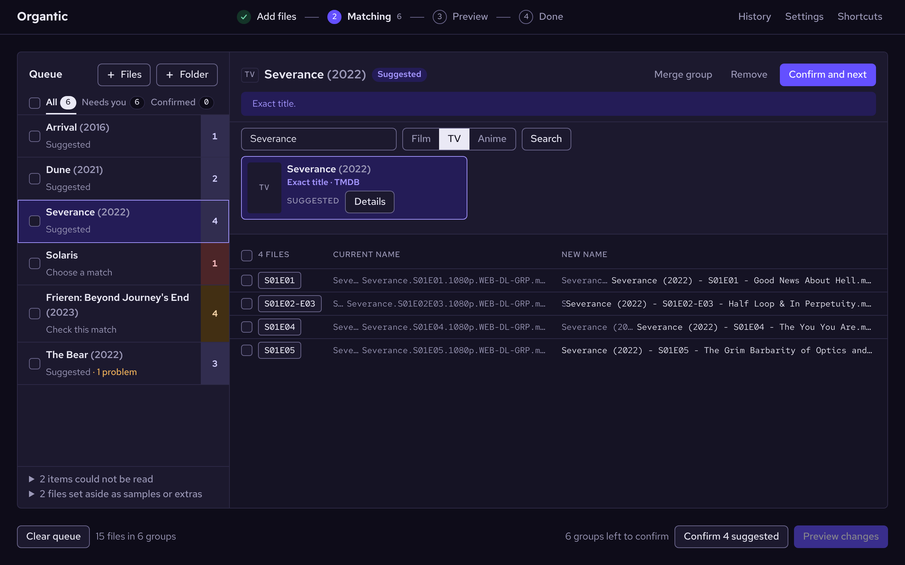
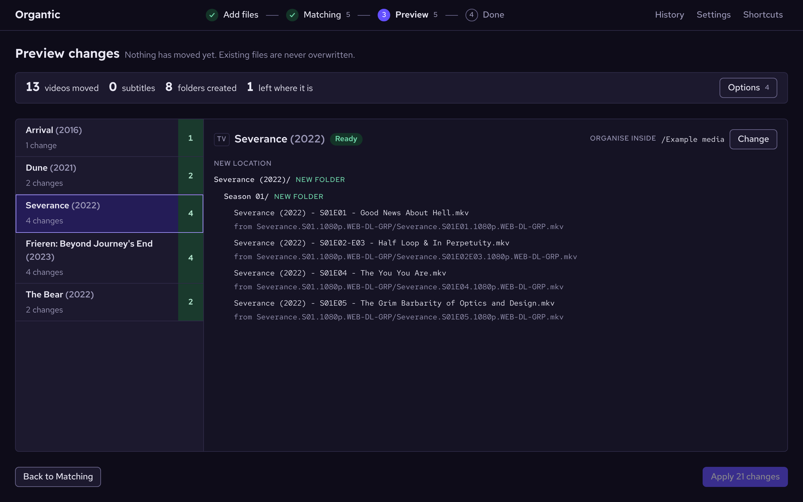
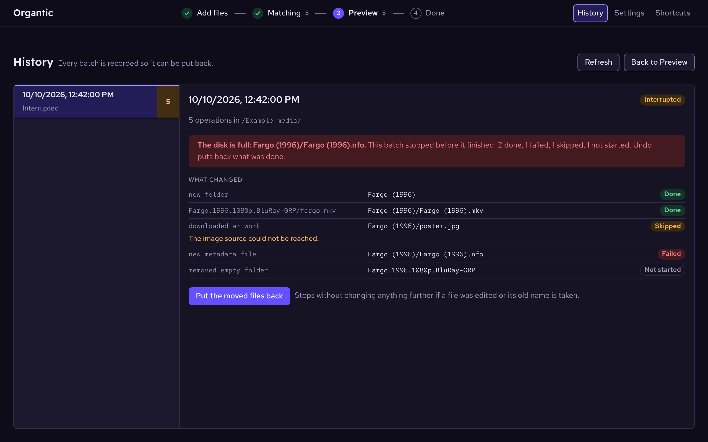
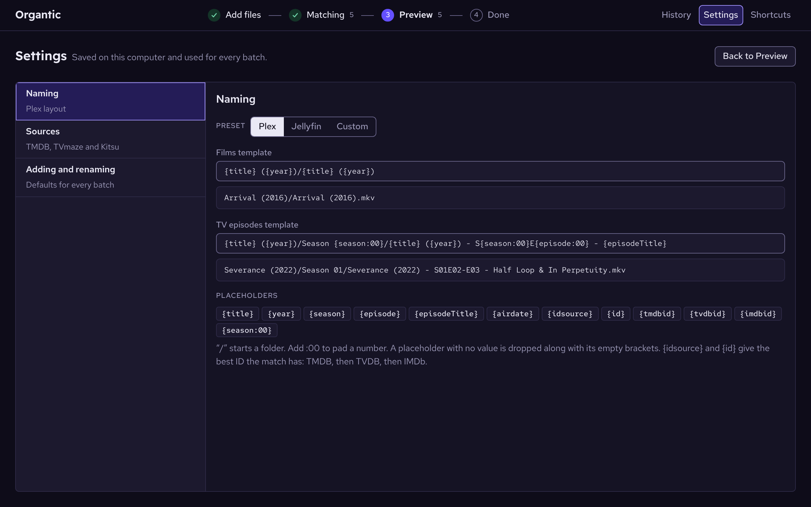

<div align="center">


<h1>Organtic</h1>

**Match movie and TV files to a catalogue, then rename them safely.**<br>
Local-first, keyboard-friendly, and nothing moves that the preview did not show.

[](https://github.com/jtroutdev/organtic/actions/workflows/ci.yml)


[Run it](#run-it) · [The workflow](#the-workflow) · [Naming](#naming) · [Sources](#metadata-and-sources) · [Anime](#anime) · [File safety](#file-safety)

</div>

<p align="center">
  
</p>

Organtic is an independent desktop application built with Electron and Vue on a reusable TypeScript core. Original code is MIT licensed. This is an early development version.

| Before | After |
| --- | --- |
| `Arrival.2016.1080p.BluRay.x264.mkv` | `Arrival (2016)/Arrival (2016).mkv` |
| `Severance.S01E01.2160p.WEB.mkv` | `Severance (2022)/Season 01/Severance (2022) - S01E01 - Good News About Hell.mkv` |

## Contents

- [What it does](#what-it-does)
- [Run it](#run-it)
  - [Releases and checksums](#releases-and-checksums)
- [The workflow](#the-workflow)
  - [Add files](#1-add-files)
  - [Matching](#2-matching)
  - [Preview](#3-preview)
  - [Apply](#4-apply)
  - [History and Settings](#history-and-settings)
  - [Keyboard](#keyboard)
- [Naming](#naming)
  - [What is read from a file name](#what-is-read-from-a-file-name)
  - [Episode order](#episode-order)
  - [Episodes named by air date](#episodes-named-by-air-date)
  - [Copies of the same title](#copies-of-the-same-title)
- [Metadata and sources](#metadata-and-sources)
  - [How a search works](#how-a-search-works)
- [Anime](#anime)
- [What travels with a video](#what-travels-with-a-video)
- [Where files go](#where-files-go)
- [File safety](#file-safety)
- [Current limits](#current-limits)
- [More documentation](#more-documentation)

## What it does

- **A four-step wizard.** Add files, Matching, Preview, Done. The header shows where you are, and each step's way back and forward sits in a footer.
- **Matches you can check.** Every group says why it was matched and offers the alternatives as poster cards. Nothing is renamed on a suggestion alone.
- **Four sources, searched at once.** TMDB, TVmaze and Kitsu, with TheTVDB for anime specials. You bring your own keys; none is bundled.
- **Plex and Jellyfin naming, or your own.** Presets, or templates built from placeholders with a live example.
- **Anime handled properly.** Fansub names, absolute numbering, and Kitsu entries placed in the season Plex expects.
- **Sidecars come along.** Subtitles, NFO files and artwork move with their video, and new NFO files and artwork can be written.
- **A preview that is the plan.** A folder tree of every change, with problems shown on the files involved and Apply held until they are settled.
- **Undo.** Every batch is journaled before it runs. History lists each one, shows what became of every change, and puts it back.
- **Private.** No analytics, accounts, background scans or automatic jobs. A search sends a title, never media bytes or full paths.
- **Usable without a mouse.** Shortcuts throughout, a single tab stop per list, and outcomes announced to screen readers.

## Run it

Install Node.js 24 or later, then run these commands in this folder (works in Fish, Bash, and PowerShell):

```sh
npm ci
npm start
```

`npm start` builds and launches the desktop app. Linux requires a desktop session and Electron's system libraries.

`npm run dev` serves a browser preview at [http://127.0.0.1:47831](http://127.0.0.1:47831), marked **Example mode**. It runs the real queue logic over clearly labeled example files and a canned catalogue; it cannot access or rename your files or contact a metadata source. The server stops with an error if port 47831 is occupied instead of silently choosing another port. To override it, run `npm run dev -- --port 47832`.

| Command | What it does |
| --- | --- |
| `npm test` | Core tests using temporary files; no personal media |
| `npm run typecheck` | Type-check the core, desktop layer, tests and Vue components |
| `npm run build` | Build the interface and compile the desktop code |
| `npm run package` | Unpacked desktop build for the current platform |
| `npm run dist` | Installer for the current platform |

Build Windows, macOS, and Linux installers on their respective operating systems. Packaging configuration and a three-platform CI workflow are provided; only Linux has been built locally. Signing/notarization credentials and public releases are not configured.

### Releases and checksums

Pushing a tag that matches the version in `package.json` (`v0.2.0` for `0.2.0`) runs the release workflow. It builds the installer on each platform and drafts a GitHub release holding them and `SHA256SUMS.txt`; the draft is published by hand. Installers are not signed.

To check a download, put `SHA256SUMS.txt` beside it and run one of these. Each should report `OK` for the file you have.

```sh
sha256sum --check --ignore-missing SHA256SUMS.txt   # Linux
shasum -a 256 --check --ignore-missing SHA256SUMS.txt   # macOS
```

On Windows, compare the line for your file with the output of `Get-FileHash .\Organtic-0.2.0-win-x64.exe -Algorithm SHA256` in PowerShell.

> [!NOTE]
> A matching checksum shows the file arrived as it was built. It does not show who built it; only signing can.

## The workflow

The header shows the four steps, **Add files**, **Matching**, **Preview** and **Done**, with the number of groups in the queue and the number confirmed. A step you can go to is a button. **History** and **Settings** sit beside them and each has a Back button named for the step it returns to.

### 1. Add files

- Add files or a folder with the buttons, or drop them on the window. The file browser reopens where it was last used.
- Folders are read recursively. Hidden entries and symbolic links are skipped.
- Samples, trailers, and extras are set aside. They are listed under the group list on Matching and can be included by hand.
- One folder that cannot be read does not fail the import. Everything else is taken, and Matching lists what could not be read or would not be followed, each with why.
- Import is limited to 20,000 entries.

### 2. Matching

Files are grouped by show or film and looked up straight away, three groups at a time. Matching shows how many are done and can cancel the rest; cancelled groups keep any match they already had and can be searched by hand.

Each group is one of:

| Status | Meaning |
| --- | --- |
| **Suggested** | A clear match |
| **Check this match** | The closest result, not a certain one |
| **Choose a match** | Nothing fits, or several fit equally |

Work down the list. Each group shows a note saying how it was read and matched, the alternatives as a strip of poster cards with their details a click away, and every file's current and new name side by side.

- **Confirm or change the match.** Use **Confirm and next**, pick another result, or search again with a different title, type (Film, TV or Anime), or source. **Confirm N suggested** confirms all the clear matches at once.
- **Step through problems.** The file list's header counts the group's problems and steps back and forth through them, by button or `F8` and `Shift`+`F8`. The problem in hand opens its form where it sits; saving, or leaving the file out, moves on to the next. A file left out can be included again.
- **Fix a number.** A wrongly read or missing season or episode number can be corrected per file; leave the season empty for an absolute episode number. A file whose episode still cannot be found is left where it is.
- **Fix the grouping.** Tick one or more files and move them to another group or to a new group of their own, or merge a whole group into another. Moved files take on the destination group's match and type.
- **Work on several groups.** Each group has a tick box, with select-all beside the filters, to merge or remove groups together. `Shift`-click ticks a range and `Ctrl`-click ticks without opening.
- **Sort the files.** A column heading sorts ascending, then descending, then puts the queue's order back. Stepping through problems follows the order on screen.
- **Wrong values are marked where they were typed.** A bad season or episode, an empty search, a faulty template or a rejected key marks its own field and says why beside it.

### 3. Preview

Preview opens once every group is confirmed or removed.

<p align="center">
  
</p>

- The confirmed groups are shown as a folder tree with counts. While the preview is being built the page keeps its shape, outlined.
- Problems such as two different episodes getting the same name are shown on the files involved and block Apply until one is left out.
- [Copies of the same title](#copies-of-the-same-title) are kept as versions, and likely exact duplicates are pointed out with an offer to leave them out.
- Each group can be given [its own destination folder](#where-files-go).
- The folders a batch writes to are checked for being writable and for room for the NFO files, artwork and history record, here and again before the batch starts. System errors are put in plain words with their path.
- The options menu holds the choices for this batch, such as removing folders left empty.

### 4. Apply

**Apply** opens a native confirmation. Renamed files leave the queue; everything else stays. The wizard ends on **Done**, which says how many operations completed and where.

### History and Settings

**History** lists every batch and can undo it. For a batch that stopped, it shows what became of each change (done, failed, skipped or not started), with the reason it stopped given once at the top. A batch the app died in is told apart from one that failed.

<p align="center">
  
</p>

**Settings** has three parts:

| Part | Holds |
| --- | --- |
| **Naming** | The preset or your own templates, with a live example of each |
| **Sources** | The TMDB token, the TVDB key, the language for titles, and the Kitsu options |
| **Adding and renaming** | The defaults for organising, subtitles, NFO files, artwork and empty folders |

### Keyboard

| Keys | Action |
| --- | --- |
| `Ctrl`+`1` … `4` (`⌘` on macOS) | Open Matching, Preview, History, or Settings |
| `↑` `↓` `Home` `End` | Move through a list when it has focus |
| `Alt`+`↑` / `Alt`+`↓` | Previous or next item in the list, from anywhere |
| `Ctrl`+`Enter` | Confirm and next on Matching; Apply on Preview |
| `F8` / `Shift`+`F8` | Next or previous problem in the group's files on Matching |
| `/` | Jump to the title search on Matching |
| `Ctrl`+`O` / `Ctrl`+`Shift`+`O` | Add files / add a folder |
| `Esc` | Close an open form or clear the file selection |
| `?` | Show the shortcut list |

Each list is a single tab stop, page changes move focus to the page heading, outcomes are announced to screen readers, and the interface follows the system light or dark theme. Linux and Windows have no menu bar; macOS keeps its menu in the system bar.

## Naming

Settings offers a **Plex** preset (the default), a **Jellyfin** preset, and **Custom** templates for films and episodes.

| Placeholder | Gives |
| --- | --- |
| `{title}` `{year}` | The matched title and its year |
| `{season}` `{episode}` | The numbers; add `:00` to pad, as in `{season:00}` |
| `{episodeTitle}` | The episode's name |
| `{airdate}` | The air date, which may stand in for `{season}` and `{episode}` |
| `{idsource}` `{id}` | The best ID the match has: TMDB, then TVDB, then IMDb |
| `{tmdbid}` `{tvdbid}` `{imdbid}` | Each ID individually |

`/` starts a folder. A placeholder with no value is dropped along with its empty brackets.

<p align="center">
  
</p>

- The Plex preset names folders by title and year alone, which is what Plex matches on. Its optional `{tmdb-…}` folder tag is left out, because braces have to be written as `%7B` and `%7D` wherever a path becomes a URL. A custom template can add the tag back as `{{idsource}-{id}}`.
- The Jellyfin preset keeps that player's `[tmdbid-…]` tag.
- A show matched on TVmaze is tagged from the IDs TVmaze lists for it, and gets no tag if it lists neither.
- Names are made safe for every platform: characters a filesystem refuses, Unicode direction overrides that can make a file display under another name, and the device names Windows reserves are all dealt with.

### What is read from a file name

| Form | Examples |
| --- | --- |
| Standard | `S01E01` |
| Multi-episode | `S01E01E02`, `S01E01-E02`, named in Plex's `S01E01-E02` form |
| Looser season forms | `S08 E12`, `S08-E12`, `[8x12]`, `[3.21]`, `0812`, and `812` inside a `Season 8` folder or where the show has no episode 812 |
| Fansub, absolute numbers | `[Group] Show - 12` |
| Production codes | `Show - 201a - Title`, `310a&b - Title`; the code gives the season and the episode is found by its name |
| Air dates | `Show.2024.03.15.mkv`, `Show - 2024-03-15 - Title.mkv` |
| Specials | `S00E02`, a `Specials` folder, `[Group] Show - OVA 02`, `Show - SP1` |

- Absolute numbers can be converted to seasons by counting through the provider's regular seasons; shows whose provider seasons do not follow that order will map incorrectly.
- A file with no usable number is matched by the episode name in its filename when exactly one episode of the show is a close fit; a name that fits none, or more than one, is reported for the file.
- Collection folders (`Show Complete Season 5`, `Show - The Complete Series`, `Show Seasons 1-20`) give the show's name without the collection words, and a shorter name in a file takes the fuller one from its folder.
- Bracketed and braced blocks such as `[Group]` and `{C_P}` are dropped.
- A film's year is the last year in the name, so `2001.A.Space.Odyssey.1968` and `1917.2019` keep the number in the title. A year in parentheses or square brackets in front, as in `(1999) The Matrix` or `[1999] The Matrix`, is read as the year. A bare year in front, as in `1999 - The Matrix`, is searched as written first and then as the year (see [How a search works](#how-a-search-works)).
- Samples, trailers, and Plex extras folders are flagged.

### Episode order

When a show has other orderings (TMDB's episode groups such as DVD, absolute or story arc; TVmaze's alternate lists such as DVD release), Matching offers **Files are numbered in**. Choosing one reads the files' season and episode numbers in that order.

- By default the new names are converted to the usual aired numbering, which is what Plex expects out of the box.
- **Keep these numbers in the new names** keeps the files' own numbers instead, with the titles of the episodes actually in those positions, for a library set to that order.
- A multi-episode file whose episodes are not next to each other in aired order can only be named with its own numbers kept.
- Season posters are not downloaded for groups read in another order.

### Episodes named by air date

Files such as `Show.2024.03.15.mkv` are matched to the episode that aired that day and named with its season and episode number like any other.

- If nothing is listed for that day, or more than one episode aired, the file says so and the season and episode can be set by hand.
- Dates are matched exactly, so a name dated a day off from the provider's listing will not match.
- Dates are read in year-month-day order only, and a day the calendar does not have (`2024.02.31`) is not taken as a date.
- Custom templates can put the date in the name with `{airdate}`.

### Copies of the same title

Copies of the same film or episode are kept as versions instead of clashing. The best one takes the plain name and each other gets a label after it, such as ` - 720p x264`, or ` - Copy 2` when the names give nothing to tell them apart.

Copies are told apart first by resolution, source and codec as read from their names and folders, then by size; nothing is read from inside the files. Preview says which file each was treated as a version of. Files whose own names give different episode numbers are still reported as a clash. A written NFO goes with the plain name only.

## Metadata and sources

No credential is bundled. Keys are encrypted with the operating system's keychain and saved in the app's data folder. Where no keychain is available (some Linux sessions), they are kept in memory until exit and the app says so.

| Source | Covers | Key | Notes |
| --- | --- | --- | --- |
| **TMDB** | Films, shows, episode titles | Your own API **read access token** (not the short v3 API key) | Films need a TMDB token, apart from anime films, which Kitsu also lists. [API usage and attribution](https://developer.themoviedb.org/docs/faq) |
| **TVmaze** | TV shows | None | Used for shows when no TMDB token is set. Data is licensed CC BY-SA; attribution and share-alike conditions apply independently of this app's MIT license. [API documentation and license](https://www.tvmaze.com/api) |
| **Kitsu** | Anime, with romaji, English, and Japanese titles and per-episode titles | None | Only used for groups searched as **Anime**; see [Anime](#anime). [Kitsu API](https://kitsu.docs.apiary.io) |
| **TheTVDB** (optional) | Titles for anime specials numbered as TVDB lists them | Your own v4 API key, and a subscriber PIN if your key requires one | The key is checked by signing in when you save it. [API information](https://thetvdb.com/api-information) |

Embedded container metadata is not implemented.

### How a search works

- Every search sends the entered title and filters to all the sources for that group at once: TMDB when a token is set, TVmaze for shows, and Kitsu for groups searched as anime. A title is never sent to Kitsu otherwise.
- Results are ranked together by how well they fit the filename. The same title from two sources is not treated as a conflict; the source searched first is suggested.
- When a name starting with a year, such as `1999 - The Matrix`, finds no certain match as written, the rest of the name is searched again with that number as the year. The group says when its match was found this way.
- A source that cannot be reached is named on the group and the others' results are still offered. Provider errors are displayed as errors, not empty successful searches.
- Search does not upload media bytes or full local paths. No analytics, accounts, background scans, or automatic rename jobs are included.

## Anime

A group is searched as **Anime** when it looks like a fansub-style release (a leading `[Group]` tag, or episode numbers with no season), or when the Film, TV, Anime selector on Matching is set to it. Kitsu is used for these groups in two ways:

1. It is searched along with the other sources, and its results are offered beside theirs on Matching.
2. When such a group is not matched with confidence, Kitsu's other titles for it are looked up and every source is searched again under the English one; only an exact title match on Kitsu is trusted. This second search can be turned off in Settings.

Each season or part is usually its own entry on Kitsu, numbered from 1. The rest of this section is about putting those entries where Plex expects them.

<details>
<summary><b>Placing Kitsu entries in their TMDB or TVDB season</b></summary>

<br>

The app can use a community-maintained list ([Fribb/anime-lists](https://github.com/Fribb/anime-lists)) that ties Kitsu entries to TMDB and TVDB shows, seasons, and episode offsets. A second part that starts twelve episodes into season 3 is therefore named from `S03E13`, and a template with an ID tag gives it the TMDB one.

- **Off by default**, and turned on in Settings under Sources, because neither list states its terms of use (see the [third-party notices](THIRD_PARTY_NOTICES.md)).
- **With it on**, the list (about 7 MB) is downloaded from GitHub the first time Kitsu is used as a source, reduced to a small checked index in the app's data folder, refreshed weekly, and reused if a refresh fails.
- **With it off**, nothing is downloaded and a Kitsu match keeps its own entry's name, the TVDB season Kitsu itself records where it has one, and otherwise the season the file claims.

Which numbering and tag are used, in order: TMDB's when the list has them, otherwise TVDB's, otherwise the TVDB season Kitsu itself records, otherwise the season the file claims or season 1 with no tag.

**Folders and posters.** A later season or part is filed under the show's own name and year, taken from the Kitsu entry the list marks as the show's first, so "Attack on Titan Season 3 Part 2" goes in `Attack on Titan (2013)/Season 03/` beside the rest. The show's poster and backdrop then come from that first entry, and the later entry's own poster is used as the season poster. An entry the list does not know keeps its own name and folder.

</details>

<details>
<summary><b>Episodes that break an entry's pattern</b></summary>

<br>

The list's upstream ([Anime-Lists](https://github.com/Anime-Lists/anime-lists), a further 3.5 MB download) also records the episodes that break an entry's pattern, and those are applied first:

- a long-running entry split into catalogue seasons by episode range (One Piece's episode 62 becomes `S02E01`);
- a recap the catalogue files under specials;
- one episode that the catalogue splits in two;
- an episode it does not have at all, which is reported so the file can be set by hand or left out.

A multi-episode file that would straddle such a boundary is reported and not misnamed. The rules assume Kitsu numbers an entry's episodes the way AniDB does, which is usual but not guaranteed.

</details>

<details>
<summary><b>Specials</b></summary>

<br>

A file marked as a special (`S00E02`, a `Specials` folder, or a fansub name such as `[Group] Show - OVA 02` or `Show - SP1`) and matched to a regular Kitsu entry is taken as one of that entry's own specials and placed by the list's rules for them, in the catalogue's specials or wherever it keeps that episode.

Kitsu has no titles for these, so the title, air date and description come from:

- **TMDB's** listing of that exact season and episode, when the numbers are TMDB's and a TMDB token is set;
- **TVDB's** listing, in the language chosen for titles, when the numbers are TVDB's and you have added your own TVDB API key in Settings.

Otherwise, or if the catalogue does not list that episode or has no name for it in that language, the name carries the number only.

A special the list does not place, or places nowhere, is reported and never numbered as a regular episode. The list often has these rules for TVDB only, so with TMDB numbering in use many specials will be reported this way.

</details>

<details>
<summary><b>Numbering as TMDB or TVDB</b></summary>

<br>

A Kitsu show on Matching has a **Number seasons and episodes as** switch between TMDB (the default) and TVDB. TVDB uses that catalogue's seasons, episode numbers and ID for the whole group, which brings its specials rules into play.

- The show then needs its episode ordering set to TVDB in Plex.
- If you split a show across groups, set them all the same way.
- Where the list has no TVDB numbering for an entry, TMDB's is used and the group says so.

</details>

## What travels with a video

| Sidecar | What happens |
| --- | --- |
| **Subtitles** | Matching same-stem `.srt`, `.ass`, `.ssa`, `.vtt`, `.sub`, and `.idx` files retain suffixes such as `.en.forced` |
| **Existing NFO files and artwork** | Move with their video (on by default) |
| **New NFO files** | Optional Kodi-style XML sidecars |
| **New artwork** | Optional (off by default) poster, backdrop and season posters |

**Existing NFO files and artwork.**

- Files named after the video (`Film.nfo`, `Film-poster.jpg`, `Film.fanart.png`) are renamed with it.
- A film folder's own `poster`, `fanart`, `movie.nfo` and similar, and a season folder's `season01-poster` and similar, move to the new folder when every video in the old folder is going to the same place. They are left behind if any video is staying, if the folder is the one you added, or if the destination already has a file of that name.
- A show's own files (`tvshow.nfo`, its `poster`, `fanart`, `banner` and similar, and season posters kept in the show folder) move to the new show folder only when the whole show is reorganised: every video under the old show folder, at any depth, is in the batch and they all end up under one title. One episode left out, or an unconfirmed extras folder, keeps them where they are.
- Where an existing NFO or image is arriving, a new one is not written or downloaded.

**New NFO files** contain title, year, plot, provider ID, and episode information. Text is written as it reads: only `&`, `<` and `>` are escaped, so apostrophes and quotation marks appear as themselves. Existing NFO files are never replaced. Naming compatibility does not imply NFO support in every media player. Cross-player integration has not been tested.

**New artwork** is a poster and a backdrop downloaded into each title's folder as `poster.jpg` and `fanart.jpg`, names Plex, Jellyfin and Kodi all read; Plex needs "Use local assets" enabled for the library.

- Images are fetched only over HTTPS from TMDB's and TVmaze's own image hosts, must be JPEG, PNG or WebP under 20 MB, and never replace artwork already in the folder.
- A failed download is reported and skipped; the renames still go ahead.
- Undo removes the images it saved unless they have since been changed.
- Artwork needs organising into folders and a template that gives each title its own folder.
- For shows, each season in the batch also gets its poster beside its episodes as `season01-poster.jpg` (`season-specials-poster.jpg` for specials), skipped if that folder already has a season poster.
- Images remain subject to their provider's terms.

## Where files go

By default files are organised into Plex folders (`Show (2022)/Season 01/…`, `Movie (2016)/…`) created inside the folder you imported. Turning organising off renames in place.

- **Existing folders are reused.** An existing folder whose name differs only by case is reused.
- **An imported title folder is renamed, not nested.** When the folder you imported is itself one title's folder, it is renamed instead of getting a second title folder inside it: importing `Home Movies` gives `Home Movies (1999)/Season 01/…`, not `Home Movies/Home Movies (1999)/…`. That happens only when every file confirmed from the folder belongs to that one title, the folder is named after it (`Show`, `Show (1999)`, `Show.S01.1080p`), and no other folder beside it already has the new name. The rename is the last step of the batch and the first one undone, and anything else in the folder stays in it.
- **Each group can have its own destination.** Each group is organised inside the folder its files were added from unless another is chosen for it in Preview, which is how a film found among a show's episodes is sent to the films folder while the episodes stay put. The choice belongs to that group alone and must be on the same drive as the group's files: a folder on a different drive, network share or mount is refused when it is chosen.
- **Nothing leaves the imported folder otherwise.** Nothing is moved outside the imported folder unless a group is given another destination, and never across volumes.
- **Empty source folders are removed.** Source folders that organising leaves completely empty are removed as part of the batch, listed in Preview, and put back by undo. A folder that still holds anything (samples, artwork, notes, hidden files) is kept, as is the folder you added and any folder files are being moved into. This can be turned off in Settings or Preview.

## File safety

> [!IMPORTANT]
> No file is ever replaced, and nothing moves that the preview did not show. Batches are still **not filesystem transactions**; read the limits below before trusting one with a library you cannot rebuild.

- **Plans are made by the main process.** Plans are created in the main process from imported files and confirmed provider results. The renderer cannot submit arbitrary filesystem operations.
- **Every target is checked.** All targets are checked for existing files and case/Unicode-equivalent names. Duplicate targets and case-only renames are blocked.
- **Sources are checked again.** Source size and modification time are checked again before execution and before undo. These checks are not content hashes and cannot detect edits that preserve both values.
- **Moves cannot overwrite.** Files use a hard-link-then-unlink operation to avoid rename's overwrite behavior. On filesystems without hard links (exFAT, FAT, many network shares) the app falls back to checking that the destination is free and then renaming; a file created at the destination in the instant between that check and the rename is the one case this cannot rule out. The fallback is covered by tests that simulate the missing hard-link support; it has not yet been run on real exFAT or SMB volumes.
- **Every step is journaled first.** Journals are flushed before each operation. Interrupted batches can leave both paths referring to the same file. Recovery recognizes that state.
- **Undo is cautious.** Undo refuses changed video files, occupied original paths, and changed NFO contents. This assumes folders are not being concurrently modified by another program; pause other organizers while applying or undoing.

## Current limits

- **Not all-or-nothing.** A failure can leave a partially applied batch. History retains the plan for recovery. Undo can also stop partway at a conflict; earlier reversals remain recorded. No all-or-nothing or power-loss durability guarantee is made.
- **Journals are plain files.** Journal files in Electron's per-user application data directory contain absolute paths and metadata. They are local and not encrypted. Keep them until you no longer need recovery.
- **One drive per group.** Files are never moved across volumes.
- **Not supported.** Disc structures, music, and embedded container metadata.
- **Not yet done.** Installers are unsigned, only Linux has been built locally, and the no-hard-link fallback has not been run on real exFAT or SMB volumes.

The screenshots are of the dark theme in example mode, which uses example files and a canned catalogue.

## More documentation

| File | What is in it |
| --- | --- |
| [docs/ARCHITECTURE.md](docs/ARCHITECTURE.md) | How the core, the desktop layer and the interface fit together |
| [docs/VALIDATION.md](docs/VALIDATION.md) | What is tested and what is not |
| [THIRD_PARTY_NOTICES.md](THIRD_PARTY_NOTICES.md) | Licences and terms for dependencies, fonts and metadata sources |
| [CONTRIBUTING.md](CONTRIBUTING.md) | Reporting a bug or contributing a change |
| [SECURITY.md](SECURITY.md) | Reporting a security problem privately |
| [AGENTS.md](AGENTS.md) | The starting point for coding agents, and the map of all documentation |
