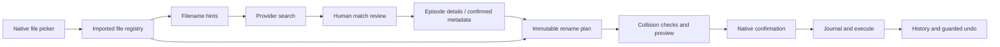

# Architecture

## Contents

- [Product boundary](#product-boundary)
- [Components](#components)
- [Data flow](#data-flow)
- [Journal model](#journal-model)
- [Provider contract](#provider-contract)
- [Metadata direction](#metadata-direction)

## Product boundary

Desktop first, movies and TV, explicit match review, then safe preview and apply. Local files remain authoritative. Metadata providers supply candidates; they never initiate writes. This initial implementation is independent of FileBot and tinyMediaManager.

The referenced [FileBot fork's license](https://github.com/mobeigi/filebot/blob/master/LICENSE.md) includes a restriction concerning competing clones. No FileBot source, algorithms, UI assets, or binaries were copied into this project. The license was reviewed to decide against code reuse. Similar user-facing workflows do not require using that implementation.

## Components

| Layer                 | Responsibility                                                                                                |
| --------------------- | ------------------------------------------------------------------------------------------------------------- |
| `src/`                | Vue interface: one store; a wizard (Add files, Review, Preview, Done) plus History and Settings, on a shared split view |
| `desktop/main.ts`     | Starts the app: the window, the session, the providers and the menu; ties Electron to the modules below        |
| `desktop/handlers.ts` | Every request the window can make, IPC sender and argument checks, native dialogs, saved settings; Electron given as arguments |
| `desktop/keys.ts`     | The TMDB token and TVDB key: keychain-encrypted when there is a real keychain, never written otherwise           |
| `desktop/exitGuard.ts` | Runs apply and undo one at a time, and asks before the window closes or the app quits during one             |
| `desktop/settingsFile.ts` | Reads saved settings, moving an unusable file aside; writes them to a temporary file and renames it into place |
| `desktop/appLog.ts`   | The log for bug reports: start-up and errors only, home folder as `~`, tokens and keys hidden, two files of 256 KB |
| `desktop/preload.cjs` | Narrow named commands exposed across context isolation                                                        |
| `core/parse.ts`       | Filename and folder hints: titles, years, season/episode, multi-episode ranges, absolute numbers, extras      |
| `core/group.ts`       | Grouping files by show or movie; ranking provider candidates and deciding when a match needs review           |
| `core/animeMap.ts`    | Downloads, validates, and caches the community list that places Kitsu entries in TMDB and TVDB seasons          |
| `core/session.ts`     | The queue: groups, lookups, confirmations, per-group preview, and what leaves the queue on apply; sends what changed |
| `core/queueUpdate.ts` | Applies the session's updates to the queue the interface holds                                                |
| `core/settings.ts`    | Defaults and validation of saved settings                                                                     |
| `core/api.ts`         | The contract between the interface and the app, implemented over IPC and by the browser preview               |
| `core/naming.ts`      | Naming templates (Plex preset), template validation, portable name formatting                                 |
| `core/versions.ts`    | Copies of one title that would take the same name: the best keeps it, the others are named as versions        |
| `core/paths.ts`       | Paths as text: the folder a batch's changes share, and whether one path lies inside or below another           |
| `core/http.ts`        | Reading a reply with a byte limit, so a source cannot decide how much the app holds in memory                |
| `core/media.ts`       | Supported extensions and NFO serialization                                                                    |
| `core/types.ts`       | Shared types for files, matches, plans, and journal events                                                    |
| `core/providers.ts`   | TMDB, TVmaze and Kitsu adapters, and TheTVDB for the titles of anime specials; normalization, episode resolution, bounded memory cache, timeout and 429 retry |
| `core/throttle.ts`    | Spaces requests to each host within its limit; a request over the limit waits its turn, a 429 pauses the host  |
| `core/files.ts`       | Scanning, plan validation, no-replace operations, durable journal events, conservative undo                   |
| `src/demo.ts`         | Browser preview: the real session over example files and a canned catalogue; no filesystem or network access   |

Electron is a pragmatic starting point for one-language maintenance and consistent rendering. The tradeoff is a larger runtime than a native system-webview app such as Tauri. Core modules remain UI-independent and can later serve a CLI. Future services should extend these contracts instead of adding filesystem access to the renderer.

The packaged app is locked down further than a development run. Its Electron fuses turn off running as plain Node (`ELECTRON_RUN_AS_NODE`), `NODE_OPTIONS` and the `--inspect` switches, load the app only from `app.asar`, and have Electron check the archive's integrity where it can (macOS and Windows); the file protocol keeps its usual privileges because the page is loaded from a `file:` URL. The build takes the dev server's websocket out of the page's content security policy (`scripts/pagePolicy.ts`), and fails rather than ship a policy it could not change; the policy refuses forms in both. On macOS a packaged build's menu has no View menu, so reload and devtools are for unpackaged runs only. Nothing from `node_modules` is packaged: the interface and its fonts are bundled by Vite, and the desktop process needs only Electron and Node.

## Data flow

Every request is checked twice. `desktop/handlers.ts` refuses any sender but the window's main frame showing the interface's own page, and refuses an argument whose runtime type is not the one the request's signature claims, before the argument is used. The session and `core/` then check their own invariants again, because the browser preview drives the same core with no Electron boundary in front of it: a group key or file ID is resolved against what the session holds, a result index must be a whole number within the candidate list rather than merely something truthy, and a batch id must be a string before it is tested or built into a file name. The interface never sends paths or metadata, only group keys, file IDs, and result indexes that the session resolves against what it holds; the one exception is dropped files, whose paths the preload script reads from the drop itself. Queue changes reach the interface as updates, not as the whole queue: the session keeps each group's description until the group or the settings change, and sends the groups that changed, the order of the groups when one was added or removed, the skipped and unread lists when they changed, and the lookup count. Changes made within about a frame (16 ms) go out as one update; a change to many groups is described a slice of about 2,000 files at a time, letting other work run between slices, and still goes out as one update. The interface applies each to the queue it loaded with `applyQueueUpdate` (`core/queueUpdate.ts`), replacing only the changed groups, so the rest of the list is not redrawn. The browser preview sends the same updates. While Preview is open the interface builds it again only when an update adds, changes or removes a confirmed group, and builds one at a time: changes that arrive while one is on its way ask for a single further one. Planning reads each folder once and finds names by key, so preview time grows with the number of files, not with its square. Scanning asks the filesystem for a folder's canonical path once as it enters it and passes it down, rather than once per file, and gives way to the main process every 500 entries. An apply request can reference only the plan last previewed, and any change to the queue discards that plan. Apply and undo are serialized and a single app instance is enforced. Metadata searches do not mutate files.

## Journal model

Plans may end with removals of source folders the batch empties; these are journaled like any other operation, skipped if the folder is no longer empty when reached, and reversed by recreating the folder. A plan may then end with the rename of an imported folder that is itself one title's folder; because it runs last, every other path in the plan is valid while the batch is applied, and because undo runs in reverse, it is the first thing put back. A rename that cannot be made is journaled as skipped and reported, not fatal. The session follows a renamed folder so files still queued under it are found. Each batch is a JSONL file: full plan, operation intent, operation completion, and batch completion or failure. The file is held open for the whole batch. Intents are written for a run of up to 64 operations and flushed to disk together before the first of them begins; the completion records of a run reach the disk with the next run's intents, or with the batch's last record. A metadata file the batch wrote is flushed just before the completion record that names it can be, so undo never finds one cut short, and a download's completion, which carries the size undo checks, is flushed at once. A failure or stop records `started`, the last operation begun, so History shows the announced operations after it as not started; a crash can leave a run's later intents without completions, and undo passes over those as for any move that never happened. Undo writes its reversal records without a flush for each and flushes them when it ends or stops: putting an operation back is safe to repeat, so one reversed but not yet recorded is found back in place next time. Opening and flushing the record for every event cost about 4.5 ms each on an SSD, twice per operation. The plan record carries the journal format as `version` (now 1); a record without one is version 1, and a newer one is refused with a message to update the app, so History lists it as damaged and undo leaves it alone. Undo records each completed reversal. Apply and undo take an abort signal, checked before each operation: the operation in hand finishes, a stopped batch is journaled as failed with the message "You stopped the batch.", and a stopped undo simply has fewer reversals recorded, so the next undo carries on. The desktop process aborts it when the person presses Stop on Preview or History, or chooses Stop and close while closing or quitting. Apply and undo report their progress after every operation; the desktop process passes it to the window about ten times a second, always with the start and the last operation. Recovery examines both paths against stored fingerprints, including an interrupted hard-link operation with two names for one inode. A move with an intent but no completion, whose source still matches its fingerprint and whose target is a different file, never happened; undo records it as reversed without touching the target, and carries on. A truncated final JSONL record can be discarded during explicit recovery; interior corruption requires manual inspection. History lists each batch by a summary (status, why it stopped, how many changes ended each way, the folder they share), worked out from its record in one pass and kept by the desktop process until the record's size or modification time changes; a batch's changes are read only when it is selected. Those summaries are also written to `history-index.json` beside the records, so the first open after a restart reads one small file rather than every record; the index is only a cache, carries the size and modification time it was taken from, and is read again from the record whenever it is missing, unreadable, of another version or out of step. A record is read a line at a time rather than as one string, so a record of tens of megabytes never has the whole file in memory beside the events it parsed to. A finished or undone batch's record can be removed, after a confirmation, and with it the possibility of undoing it; an interrupted one is kept until it has been undone, and an unreadable one is left for recovery by hand.

This is recoverable best-effort execution, not a transactional filesystem. Metadata writes are exclusive and existing files are never replaced. A partial NFO write after a crash is conservatively left for manual review if its contents do not match the planned content. Full content hashing, directory fsync, portable atomic no-replace primitives, network-filesystem validation, and stronger concurrent-edit handling are release-hardening opportunities.

## Provider contract

A search returns normalized `provider`, `kind`, `id`, `title`, `year`, `overview`, and `sourceUrl`. TV resolution adds `episodeId`, `season`, `episode`, `episodeTitle`, and `aired`. Keep show IDs and episode IDs separate. Adapters return each source's results in its own order and give them no score. `rankCandidates` (`core/group.ts`) then scores every result against the title and year read from the files, 0.8 for the title and 0.2 for the year, keeping the sources' order between equal scores, and gives each a short reason a person can check ("Exact title, year differs"). The top result becomes the group's suggestion only when it scores at least 0.85 and is at least 0.1 ahead of the next result that is a different work; the same title from another source, a year or less apart, is not counted against it. Anything else is marked for review. Either way nothing is confirmed until a person confirms it. TheTVDB is never searched: with a key set, it gives the titles of a Kitsu entry's specials that the anime list places in TVDB's numbering, when TMDB has none for them.

Requests use fixed HTTPS provider origins, no redirects (a refused redirect is reported as the source having moved, not as being offline), a 15-second timeout, a bounded one-hour memory cache, and limited 429 retries. A route is built from values a source sent, so the address is checked against its source's own origin and path before any header is attached, and a reply is read with a byte limit (`core/http.ts`) rather than whole, since a source may state no length or the wrong one. An id a source sent is only typed as a number: it is checked to be a whole positive number before it goes into an address, and a candidate without a usable one is left out. Requests to each host go through a queue that keeps them within its limit (`LIMITS`: TMDB about 40 a second; TVmaze, which publishes 20 calls in 10 seconds, and Kitsu and TVDB, which publish none, 20 in 10 seconds); a request over the limit waits its turn in the order it asked, a 429 pauses every request to that host and is tried up to five times with a growing wait, and a cancelled lookup leaves the queue. Requests for the same address while one is on its way share it. The lookups made when files are added ask TVmaze only when TMDB's answer is not certain, or TMDB could not be searched, when a TMDB token is set; a search the person starts asks every source. Answers are cached in memory only, read through one place that checks the hour and written through one that drops the oldest at 500 entries; whether to keep them on disk is an open decision. A TVDB key change forgets what the old key fetched. TVDB's paging fields are not relied on: another page of a season's listing is asked for only while an episode that was asked for is still missing, up to ten pages. Do not share embedded developer credentials among installations.

## Metadata direction

NFO sidecars and artwork are optional outputs. Artwork is planned as download operations, one poster and one backdrop per title folder, so it is previewed, journaled, and undone like everything else. Downloads are restricted to the providers' HTTPS image hosts, to JPEG, PNG, or WebP, and to 20 MB; they are written exclusively and never replace existing artwork. A failed download is journaled as skipped and does not stop the batch. Embedded MKV/MP4 edits need separately selected container tools, capability detection, preservation of streams/tags, a backup policy, and their own explicit preview. They must not silently piggyback on a simple filename rename.
